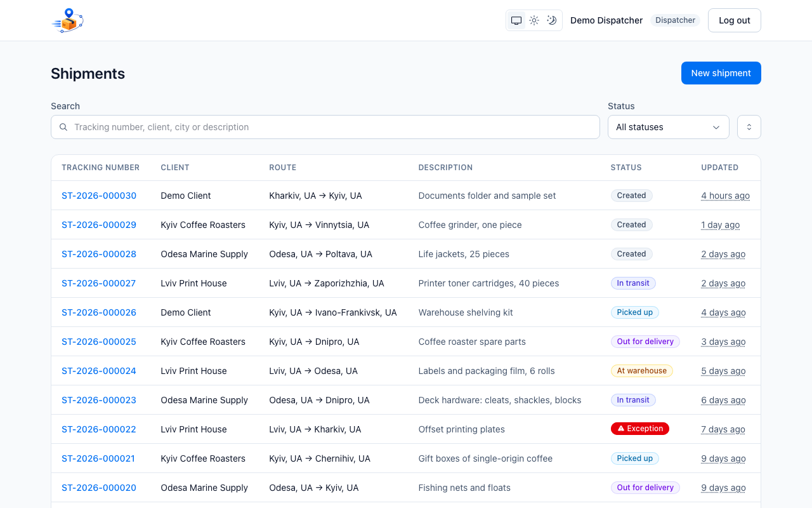
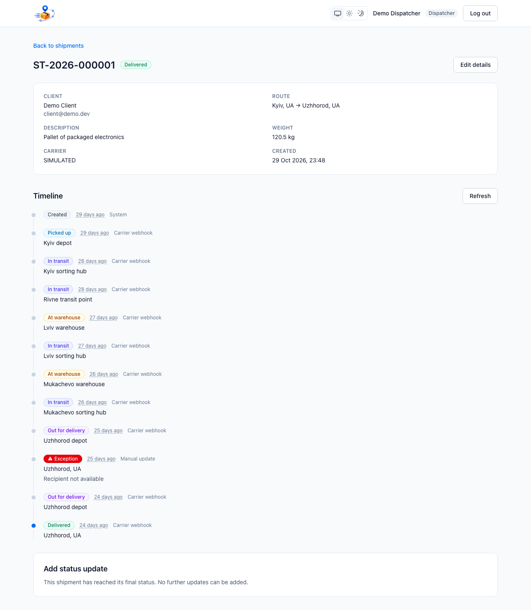
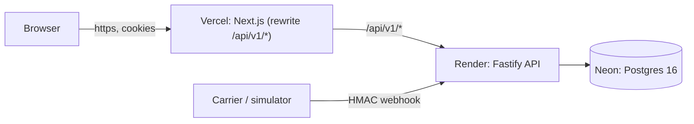
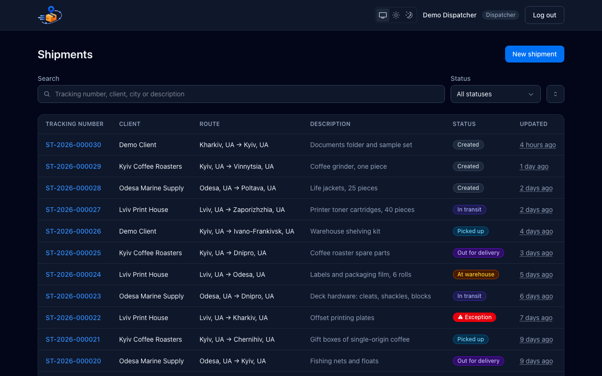
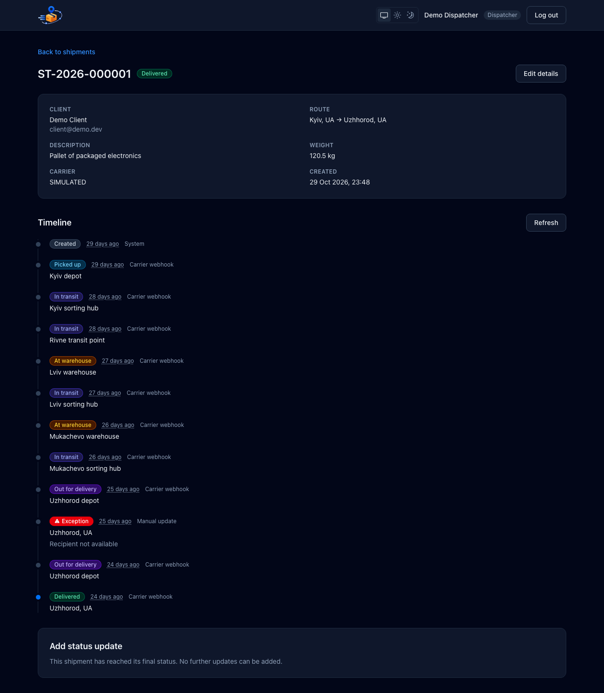
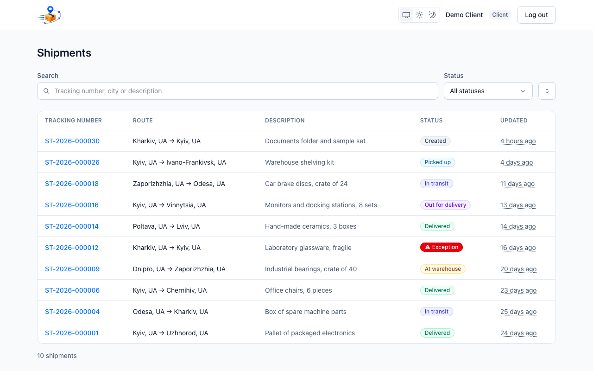
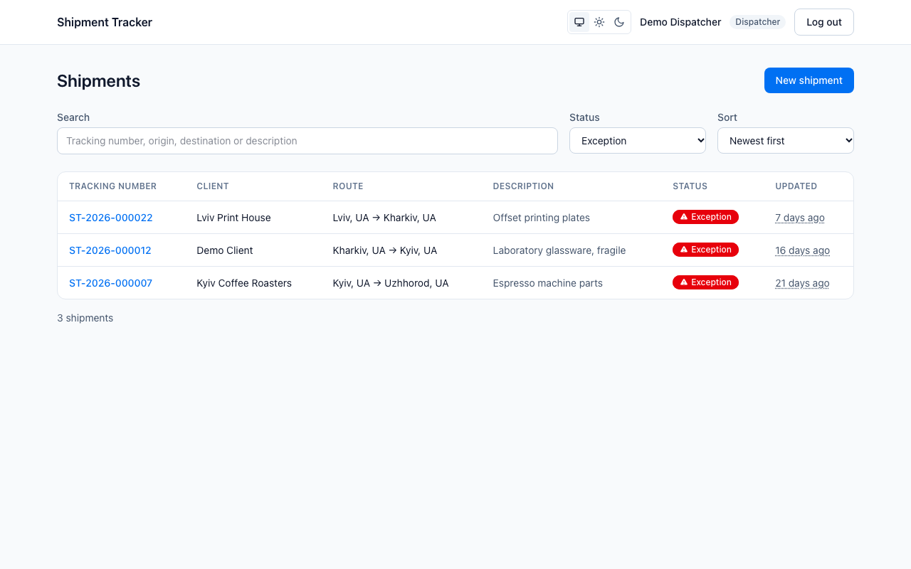
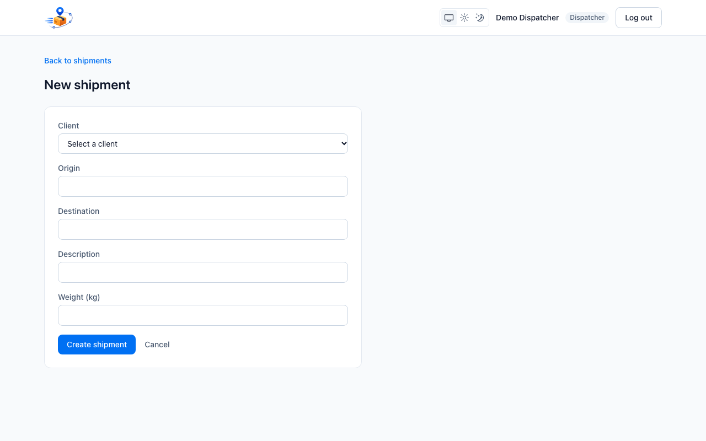
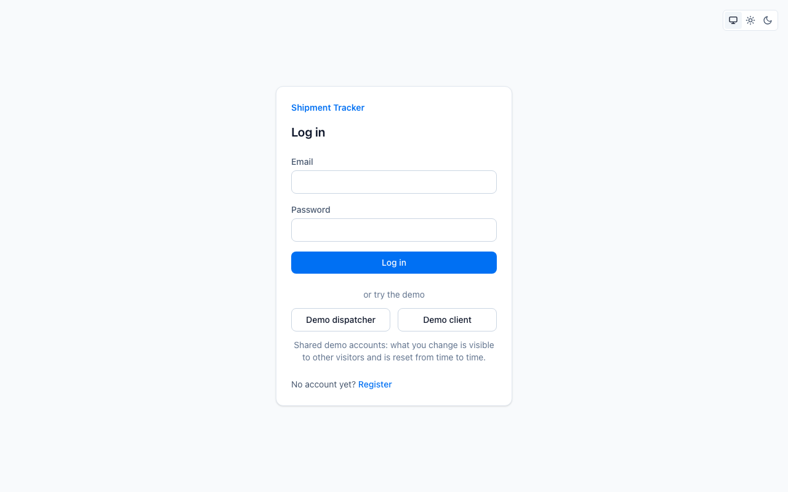

# Shipment Tracker

A logistics visibility dashboard: one place to track every shipment, regardless of carrier.

## Live demo

https://shipment-tracker-sooty.vercel.app — sign in with one click as **Demo dispatcher** or **Demo client**.

> The API runs on a free instance that sleeps when idle: the first request after a quiet spell can take up to a
> minute. The demo accounts are shared, and the demo data is reset from time to time.

| Account    | Email                 | Password        |
| ---------- | --------------------- | --------------- |
| Dispatcher | `dispatcher@demo.dev` | `dispatcher123` |
| Client     | `client@demo.dev`     | `client123`     |

| Dispatcher's shipment list                                                                                                                                                                                                           | Shipment detail                                                                                                                                                                                                                                     |
| ------------------------------------------------------------------------------------------------------------------------------------------------------------------------------------------------------------------------------------ | --------------------------------------------------------------------------------------------------------------------------------------------------------------------------------------------------------------------------------------------------- |
|  |  |

## Why I built this

I ran a logistics company for 12 years. Again and again I saw the same problem with small shippers: their
parcels were split across several carriers, each with its own portal, and nobody had one view of where
everything was. Answering "where is my order?" meant logging in to several carrier websites.

Shipment Tracker is the tool I wished I had then: one dashboard for every shipment, whatever the carrier.

The domain shows in the design. A shipment's movement history is append-only — an event, once recorded, is never
edited or deleted, because that history is what you rely on in a dispute. Status changes follow a strict state
machine, because a parcel cannot be delivered before it was picked up, and a carrier that says otherwise has
sent bad data. And dispatchers and clients are separate roles: a client sees their own shipments and nothing
else.

## What it does

- **Two roles.** A dispatcher sees and manages every shipment; a client sees only their own. Someone else's
  shipment answers `404`, the same as one that does not exist.
- **Append-only movement timeline.** Every status change is a stored event with its time, location, note and
  source (system, manual update or carrier webhook).
- **A strict state machine.** 20 of the 49 possible status pairs are legal; anything else is rejected with `422`.
  The server sends `allowedNextStatuses` with each shipment, so the UI never duplicates the transition table.
- **Carrier webhooks.** HMAC-SHA256-signed and idempotent (an exact duplicate is a `200` no-op), plus a carrier
  simulator CLI that fires realistic event sequences.
- **Auth done carefully.** The JWT lives in an HttpOnly cookie, never in `localStorage`; every authenticated mutating
  request carries a double-submit CSRF token (header = cookie = JWT claim).
- **Per-visitor rate limits** on login, registration and the webhook, keyed by the visitor's IP behind the proxy.
- **A dashboard** with a status filter, search (tracking number, client, city, description), four sort orders,
  pagination, manual status updates, editing a shipment's details, and a System / Light / Dark theme.
- **Cold-start aware.** While the free API instance wakes up, reads and the login are retried once, and the UI
  shows a "Waking up the demo server" notice instead of an error.

## Architecture



The browser only ever talks to the Next.js host, which rewrites `/api/v1/*` to the API, so the auth cookies are
first-party and there is no CORS at all. Request and response schemas live once in `packages/shared` (Zod) and
are used by both the API and the web forms. Carriers plug in behind a small adapter interface — the MVP ships a
simulated carrier, and a real one (Nova Poshta first) can be added without touching the shipment logic.

More in the spec: [state machine](./shipment-tracker-spec.md#6-status-state-machine),
[API and security decisions](./shipment-tracker-spec.md#7-api-design-fastify),
[carrier integration design](./shipment-tracker-spec.md#9-carrier-integration-design-post-mvp),
[CI/CD and deployment](./shipment-tracker-spec.md#11-cicd--deployment).

## Screenshots

| More screens                                                                                                                             |                                                                                                                                      |
| ---------------------------------------------------------------------------------------------------------------------------------------- | ------------------------------------------------------------------------------------------------------------------------------------ |
|                                                |                 |
|  |            |
|                 |  |

## Tech stack

| Area    | Choice                                                                                             |
| ------- | -------------------------------------------------------------------------------------------------- |
| API     | Fastify 5, TypeScript, Zod, `@fastify/jwt`, `@fastify/cookie`, `@fastify/rate-limit`               |
| DB      | PostgreSQL 16, Prisma 7                                                                            |
| Web     | Next.js 16 (App Router), React 19, TanStack Query, Zustand, React Hook Form, Tailwind CSS 4, Radix |
| Shared  | `packages/shared` — Zod schemas, types and constants used by both API and web                      |
| Tests   | Vitest, React Testing Library, Playwright                                                          |
| CI      | GitHub Actions with a Postgres service container                                                   |
| Hosting | Vercel (web), Render (API), Neon (Postgres)                                                        |

## Run it locally

Prerequisites: Node 22.13+ and Docker (for Postgres).

1. Create the API's env file and replace its two secrets (`JWT_SECRET`, `WEBHOOK_SECRET`) with fresh values from
   `openssl rand -base64 48`:

   ```bash
   cp .env.example apps/api/.env
   ```

   The web app needs no env file: it proxies `/api/v1/*` to `http://localhost:3001` by default. In Safari, also
   uncomment `COOKIE_SECURE=false` in `apps/api/.env` (it rejects `Secure` cookies over `http://localhost`).

2. Install, start Postgres, migrate and seed the demo data:

   ```bash
   npm install
   docker compose up -d
   npm run db:migrate:deploy -w apps/api
   npm run db:seed -w apps/api
   ```

3. Start the two dev servers, each in its own terminal:

   ```bash
   npm run dev -w apps/api    # http://localhost:3001
   npm run dev -w apps/web    # http://localhost:3000
   ```

4. Open http://localhost:3000 and sign in as **Demo dispatcher** or **Demo client**.

## Scripts

From the repository root:

- `npm run lint` — ESLint across the whole repo
- `npm run typecheck` — TypeScript, no emit, every workspace
- `npm run test` — Vitest, every workspace
- `npm run build` — production build, every workspace
- `npm run format` / `npm run format:check` — Prettier

In `apps/api` (run with `-w apps/api`):

- `dev` / `start` — the API with and without watch mode
- `db:migrate:dev`, `db:migrate:deploy`, `db:generate`, `db:studio` — Prisma
- `db:seed` — idempotent demo data: 5 users, 30 shipments with their events; prints the target database first
- `db:demo-reset -- --confirm <database host>` — deletes everything and recreates the demo set; refuses unless
  the host matches the `DATABASE_URL`
- `simulate` — the carrier simulator (see below)

In `apps/web` (run with `-w apps/web`):

- `dev` / `build` / `start` — Next.js
- `e2e` — the Playwright smoke test against a running stack (`E2E_BASE_URL` to point it elsewhere)
- `screenshots` — regenerates `docs/screenshots/*.png` from a running stack

The Playwright scripts need Chromium once: `npx playwright install chromium`.

## Tests

Last full run of `npm run test` (2026-11-28): **1,645 tests in 114 files, all passing.**

| Workspace         | Test files | Tests |
| ----------------- | ---------: | ----: |
| `apps/api`        |         35 |   716 |
| `apps/web`        |         73 |   728 |
| `packages/shared` |          6 |   201 |

The approach:

- **Unit tests** of the state machine (all 49 status pairs), HMAC verification, the Zod schemas and the demo data.
- **Integration tests** of the API through `fastify.inject()` against a real Postgres — a dedicated test database
  in the same Docker Postgres, migrated by Vitest's global setup and truncated between tests. They cover auth and
  CSRF, access control, the webhook contract, rate limits and every simulator scenario.
- **React Testing Library** for the forms, the timeline, status badges, the API client and the route guards.
- **One Playwright smoke test** — demo login → list → detail — run locally or against the live demo.
- **GitHub Actions** on every push to `main` and every pull request: install → migrate → lint → typecheck →
  test → build, with Postgres as a service container. The Playwright test is not part of CI.

## Carrier simulator

The simulator signs events with `WEBHOOK_SECRET` from `apps/api/.env` and posts them to the running API. On a
freshly seeded database, `ST-2026-000030` is a new shipment of the demo client, still `CREATED`:

```bash
npm run simulate -w apps/api -- ST-2026-000030 --scenario exception
```

Open the shipment as the demo client or dispatcher and the new events are on its timeline.

| Scenario        | What it sends                                                                      | Starts from |
| --------------- | ---------------------------------------------------------------------------------- | ----------- |
| `delivery`      | the default: pickup → transit → warehouse → transit → out for delivery → delivered | `CREATED`   |
| `direct`        | pickup → transit → out for delivery → delivered, no warehouse stop                 | `CREATED`   |
| `exception`     | pickup → transit → `EXCEPTION` with a note                                         | `CREATED`   |
| `recovery`      | from `EXCEPTION` back to transit → out for delivery → delivered                    | `EXCEPTION` |
| `duplicate`     | the same event twice: `201`, then `200`                                            | `CREATED`   |
| `illegal`       | `DELIVERED` straight away: `422`                                                   | `CREATED`   |
| `bad-signature` | a valid event signed with the wrong secret: `401`                                  | `CREATED`   |

Options: `--delay <ms>` between events (default 1000), `--url <baseUrl>` (default `http://localhost:3001`). The
exit code is `0` only when the API answered every step as the scenario expects. The simulator does not create
shipments. Running it against production is for the owner only ([`docs/deploy.md`](./docs/deploy.md) §5).

## Deploy

1. **Neon** — a Postgres 16 project; keep its direct (non-pooled) connection string.
2. **Render** — apply the `render.yaml` Blueprint with that `DATABASE_URL`; migrations run in the build.
3. **Seed** — `npm run db:seed -w apps/api` from a laptop with the production `DATABASE_URL` exported.
4. **Vercel** — import the repo with Root Directory `apps/web` and `API_ORIGIN` set to the API's origin.
5. **Smoke test** — the scripted checks through the rewrite, then the Playwright test against the live URL.

The full runbook, with environment variables, expected output, rollback and troubleshooting, is
[`docs/deploy.md`](./docs/deploy.md).

## Roadmap

Product:

1. Nova Poshta adapter (polling its tracking API)
2. Telegram notifications on `EXCEPTION` and `DELIVERED`
3. SLA alerts — "stuck for more than 48 hours"
4. An admin role that invites dispatchers, optionally scoped to assigned clients (M8)
5. Organizations / multi-tenancy
6. Analytics — average time between statuses

Engineering follow-ups:

- the Playwright smoke test in CI
- a PR-review GitHub Action
- a shared secret between Vercel and the API, so the API only accepts traffic through the rewrite
- refresh tokens and session revocation
- signed webhook timestamps (replay window)

---

Full specification: [`shipment-tracker-spec.md`](./shipment-tracker-spec.md) · Progress and milestones:
[`docs/plan.md`](./docs/plan.md)
