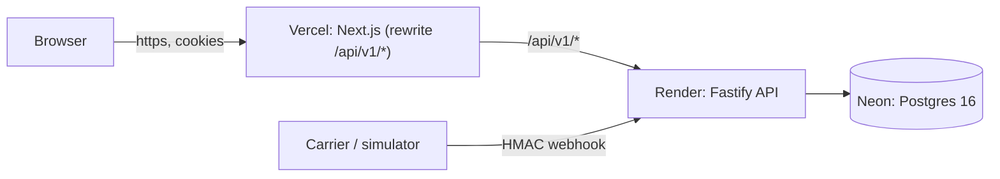

# Deploy runbook

The web app runs on Vercel, the API on Render (Free) and the database on Neon. Secrets go into the services'
dashboards, a password manager, or a shell variable — never into the repo, a file, or a chat.

## 1. Topology



The rewrite is required because the browser must see one origin: the `access_token` and `csrf_token` cookies are
host-only on the Vercel host, and a direct call to the API origin would be cross-site and would not carry them
(spec §7, Topology).

## 2. Environment variables

| Where              | Variable         | Value                                             | Notes                                                                                    |
| ------------------ | ---------------- | ------------------------------------------------- | ---------------------------------------------------------------------------------------- |
| Render             | `DATABASE_URL`   | the Neon direct string plus `&connect_timeout=15` | No `-pooler` in the host. Prompted when the Blueprint is applied.                        |
| Render             | `JWT_SECRET`     | generated                                         | Generated by Render (`generateValue`).                                                   |
| Render             | `WEBHOOK_SECRET` | generated                                         | Generated by Render; reveal it in the dashboard for the simulator.                       |
| Render             | `TRUST_PROXY`    | `true`                                            | Per-visitor rate limiting from `X-Forwarded-For`. Without it everyone shares one bucket. |
| Render             | `LOG_LEVEL`      | `info`                                            |                                                                                          |
| Render             | `PORT`           | set by Render                                     | Do not set it.                                                                           |
| Render             | `COOKIE_SECURE`  | never set                                         | The production default (`Secure`) is what is wanted.                                     |
| Vercel             | `API_ORIGIN`     | `https://<api-host>`                              | No path, no trailing slash. Production and Preview, set before the first build.          |
| Owner's shell only | `WEBHOOK_SECRET` | from Render                                       | For the simulator; never stored.                                                         |
| Owner's shell only | `DATABASE_URL`   | the Neon URL                                      | For seed and reset; never stored.                                                        |

## 3. First deploy

**Owner-only.** Secrets go into the services' dashboards, a password manager, or a shell variable — never into
the repo, a file, or a chat.

1. **Neon**
   1. neon.com → sign up → **Create project**. Name `shipment-tracker`, Postgres **16**, region **AWS Europe
      Central 1 (Frankfurt)**. Expected: a project with branch `production`, database `neondb`, role
      `neondb_owner`.
   2. **Connect** → turn **Connection pooling off** → copy the string. Expected shape (no `-pooler` in the host):
      `postgresql://neondb_owner:<password>@ep-<name>-<id>.eu-central-1.aws.neon.tech/neondb?sslmode=require&channel_binding=require`.
   3. Append `&connect_timeout=15` and keep the result in a password manager as _Neon URL_. Note its host,
      `ep-<name>-<id>.eu-central-1.aws.neon.tech` — it is the reset's `--confirm` value.

2. **Render**
   1. render.com → sign up with GitHub → grant access to the `shipment-tracker` repository only.
   2. **New → Blueprint** → the repository, branch `main`. Expected: Render shows one web service,
      `shipment-tracker-api` (Free, Frankfurt), and asks for `DATABASE_URL`.
   3. Paste the _Neon URL_ → **Apply**. Expected build log, in this order:
      - a Node 22 line (from `.nvmrc`);
      - `npm ci` adding the packages;
      - Prisma's `Generated Prisma Client`;
      - `Applying migration 20260804112818_init` and `All migrations have been successfully applied.`;
      - a successful build;
      - Fastify's `Server listening at …` and `API listening on port <port>`.

      Status **Live**; the URL is `https://<api-host>`.

   4. `curl -s --max-time 120 https://<api-host>/health` → `{"status":"ok"}`.
   5. Service → **Environment** → reveal `WEBHOOK_SECRET` → store it in the password manager (it is needed only
      for the simulator).
   6. If creating a Blueprint asks for a payment method you do not want to add: use **New → Web Service** with
      the values of `render.yaml` instead:
      - name, region, branch, Runtime _Node_, both commands, plan _Free_, health check `/health`;
      - the same env vars, generating `JWT_SECRET` and `WEBHOOK_SECRET` locally with `openssl rand -base64 48`;
      - Build Filters with the same paths.

      The build log must be the same as in step 2.3 above.

3. **Seed production from the laptop** — see [Demo data](#4-demo-data) for what it prints.

   ```bash
   read -rs DATABASE_URL && export DATABASE_URL      # paste the Neon URL; nothing is echoed or stored in history
   npm run db:seed -w apps/api
   unset DATABASE_URL
   ```

   Expected:
   1. First line `Seeding demo data into ep-<name>-<id>.eu-central-1.aws.neon.tech/neondb`. If it names
      `localhost`, press Ctrl-C at once: the variable was not exported.
   2. Then `Seeded 5 users, 30 shipments (30 new), <n> events.`
   3. Then Prisma's `The seed command has been executed.`

   Running it again prints `(0 new)`.

4. **Vercel**
   1. vercel.com → sign up with GitHub → **Add New… → Project** → import `shipment-tracker`.
   2. **Root Directory** `apps/web`; Framework _Next.js_ (detected); install and build commands left as they are;
      **Environment Variables**: `API_ORIGIN` = `https://<api-host>` (no path, no trailing slash) for
      **Production** and **Preview**.
   3. **Deploy**. Expected:
      - build log `▲ Next.js 16.2.11` and the route table of M6 (`○ /shipments`, `ƒ /shipments/[id]`,
        `○ /shipments/new`, `ƒ Proxy (Middleware)`);
      - status **Ready**;
      - the production URL is `https://<web-host>`.

      The failure mode by design: without `API_ORIGIN` the build stops with `API_ORIGIN is required: set it to
the origin of the API, e.g. https://api.example.com`.

   4. **Settings → Build and Deployment → Node.js Version** → `22.x`; if it changed, **Redeploy**.

5. **Report the two hosts** — `<web-host>` and `<api-host>` (public URLs only).

## 4. Demo data

- **Seed** — `npm run db:seed -w apps/api` with `DATABASE_URL` exported. Idempotent. Prints
  `Seeding demo data into <host>/<database>`, then `Seeded 5 users, 30 shipments (<new> new), <n> events.`;
  a second run prints `(0 new)`.
- **Reset** — `npm run db:demo-reset -w apps/api -- --confirm <host>`, where `<host>` is the database host
  (for Neon, `ep-<name>-<id>.eu-central-1.aws.neon.tech`). The flag guards against resetting the wrong
  database. Prints `Resetting demo data on <host>/<database>`, then
  `Reset demo data on <host>/<database>: 5 users, 30 shipments, <n> events.`
- Visitors' changes (new shipments, status updates, registered users) stay until the next reset.

## 5. Simulator against production

```bash
date -u +%FT%TZ; curl -sI $DIRECT/health | grep -i '^date:'
read -rs WEBHOOK_SECRET && export WEBHOOK_SECRET   # paste the secret from Render
npm run simulate -w apps/api -- ST-2026-000029 --scenario delivery --delay 500 --url $DIRECT; echo "exit=$?"
unset WEBHOOK_SECRET
ID29=$(curl -s -b "$DJAR" "$API/shipments?search=ST-2026-000029&page=1" | field '.items[0].id')
curl -s -b "$DJAR" "$API/shipments/$ID29" | field '.shipment.events.map((event) => event.status + ":" + event.source).join()'
```

**Run 6.1 first, in the same shell:** `$DIRECT`, `$API`, `$DJAR` and `field` are defined there, and `$DJAR` holds a login only after 6.1's login step.

Expected:

- The laptop's UTC time and the server's `date:` header agree within a few seconds. If the laptop runs ahead,
  fix its clock first; otherwise the API answers `400` (M4 D5).
- Six steps answered as expected and `exit=0`.
- `CREATED:SYSTEM,PICKED_UP:WEBHOOK,IN_TRANSIT:WEBHOOK,AT_WAREHOUSE:WEBHOOK,IN_TRANSIT:WEBHOOK,OUT_FOR_DELIVERY:WEBHOOK,DELIVERED:WEBHOOK`.

## 6. Smoke test

### 6.1 Live smoke test through the rewrite

In zsh (the macOS default), run `setopt interactivecomments` **on its own first**, before pasting the block.
Otherwise the trailing `# 1`, `# 2`, … are passed to the commands as arguments (`000` codes, `awk: can't open
file #`). Putting the `setopt` inside the pasted block does not help: zsh parses the whole paste before running
it.

```bash
B=https://<web-host>; API=$B/api/v1; DIRECT=https://<api-host>
DJAR="$TMPDIR/st-m7-dispatcher.txt"; CJAR="$TMPDIR/st-m7-client.txt"; rm -f "$DJAR" "$CJAR"
JSON='content-type: application/json'
code() { curl -s -o /dev/null -w '%{http_code} %{redirect_url}\n' "$@"; }
field() { node -pe "JSON.parse(require('fs').readFileSync(0, 'utf8'))$1"; }

curl -s --max-time 120 $DIRECT/health; echo                                                     # 1
code $B/shipments                                                                              # 2
curl -s $API/auth/me; echo                                                                     # 3
curl -s -c "$DJAR" -H "$JSON" -d '{"email":"dispatcher@demo.dev","password":"dispatcher123"}' $API/auth/login | field '.user.role'   # 4
curl -s -c "$CJAR" -H "$JSON" -d '{"email":"client@demo.dev","password":"client123"}' $API/auth/login | field '.user.role'           # 5
awk '$6 == "access_token" || $6 == "csrf_token" { print $1, $2, $3, $4, $6 }' "$DJAR"         # 6
DCSRF=$(awk '$6 == "csrf_token" { print $7 }' "$DJAR")
curl -s -b "$DJAR" "$API/shipments?page=1" | node -pe "const d = JSON.parse(require('fs').readFileSync(0, 'utf8')); [d.total, d.totalPages].join()"   # 7
curl -s -b "$CJAR" "$API/shipments?page=1" | field '.total'                                   # 8
curl -s -b "$DJAR" "$API/shipments?status=EXCEPTION&page=1" | field '.total'                  # 9
ID1=$(curl -s -b "$DJAR" "$API/shipments?search=ST-2026-000001&page=1" | field '.items[0].id')
curl -s -b "$DJAR" "$API/shipments/$ID1" | node -pe "const d = JSON.parse(require('fs').readFileSync(0, 'utf8')).shipment; [d.status, d.events.length].join()"  # 10
curl -s -o /dev/null -w '%{http_code}\n' -b "$DJAR" -H "$JSON" -d '{}' $API/shipments          # 11
ID30=$(curl -s -b "$DJAR" "$API/shipments?search=ST-2026-000030&page=1" | field '.items[0].id')
curl -s -o /dev/null -w '%{http_code}\n' -b "$DJAR" -H "$JSON" -H "x-csrf-token: $DCSRF" \
  -d '{"status":"PICKED_UP","location":"Kyiv depot"}' $API/shipments/$ID30/events              # 12
```

Expected, by number:

1. `{"status":"ok"}` (up to a minute if the API was asleep)
2. `307 https://<web-host>/login`
3. `{"error":{"code":"UNAUTHORIZED","message":"Authentication required"}}`
4. `DISPATCHER`
5. `CLIENT`
6. `#HttpOnly_<web-host> FALSE / TRUE access_token` and `<web-host> FALSE / TRUE csrf_token`. Both cookies
   belong to the Vercel host, are host-only and are `Secure`.
7. `30,2`
8. `10`
9. `3`
10. `DELIVERED,` followed by a number of 12 or more
11. `403` (the CSRF header is missing)
12. `201`

### 6.2 Per-visitor rate limiting behind Vercel

```bash
sleep 61    # let the login counter of the checks 4–5 above expire
for i in 1 2 3 4 5 6; do curl -s -o /dev/null -w '%{http_code} ' -H "$JSON" \
  -d '{"email":"nobody@demo.dev","password":"wrong-password"}' $API/auth/login; done; echo
curl -s -o /dev/null -w '%{http_code}\n' -H "$JSON" -H 'x-forwarded-for: 203.0.113.9' \
  -d '{"email":"nobody@demo.dev","password":"wrong-password"}' $API/auth/login
```

Expected:

- `401 401 401 401 401 429`.
- Then `429`: Vercel replaces a client-supplied `X-Forwarded-For`, so the spoofed value does not open a fresh
  bucket.

Within the same minute, from another network (a phone on mobile data): open `https://<web-host>/login` →
**Demo client** → the list loads. That is a separate bucket.

Render → service → **Logs**: the request lines of the six logins show `"remoteAddress":"<your public IP>"`.
Compare it with the address your router or any "what is my IP" page shows. Report _matches_ or _does not
match_; for a mismatch, say which kind of address appears instead (e.g. `10.x`), without pasting logs that
contain cookies.

### 6.3 Measure the cold start

Leave the demo without traffic for **at least 16 minutes** (close its tabs), then:

```bash
curl -s -o /dev/null -w 'through Vercel: %{http_code} %{time_total}s %{content_type}\n' --max-time 120 $API/auth/me
```

Then, after another ≥ 16 minutes without traffic, in a private window:

1. open `https://<web-host>/login`;
2. click **Demo dispatcher**;
3. note the seconds until the list shows, what the page showed meanwhile, and whether an error message
   appeared.

Report both. No fixed expectation:

- `401 … application/json` after 30–60 s → Vercel holds the request until the API is up, so the notice matters
  more than the retry;
- an early `502`/`503`/`504` or `200 text/html` → both matter.

### 6.4 Browser check on the live site

Chrome or Firefox:

1. A private window → `https://<web-host>` → `/login` → **Demo dispatcher** → `Page 1 of 2`, a solid red
   `Exception` badge in the list.
2. Open `ST-2026-000001` → the long timeline; the entries appear one after another.
3. DevTools → Application → Cookies: `access_token` (HttpOnly, Secure, Lax) and `csrf_token` on `<web-host>`
   only. Network: every request goes to `<web-host>/api/v1/…`. Console: no CORS error.
4. Create a shipment → its page; add a status update → `Update added.`; **Log out** → **Demo client** → 10
   shipments, no Client column.
5. Register a new client → `No shipments yet.`
6. On a phone: the same login works (also the other network of 6.2).

### 6.5 Reset the demo data

After the smoke test, reset the demo data (it now holds the smoke test's changes):

```bash
read -rs DATABASE_URL && export DATABASE_URL
npm run db:demo-reset -w apps/api -- --confirm ep-<name>-<id>.eu-central-1.aws.neon.tech
unset DATABASE_URL
```

Expected: `Resetting demo data on ep-…/neondb`, then `Reset demo data on ep-…/neondb: 5 users, 30 shipments, <n>
events.` Check 7 of 6.1 prints `30,2` again.

Never put secrets or cookie values into a report.

## 7. Measured on the deployed pair

| Date | What | Result |
| ---- | ---- | ------ |
|      |      |        |

## 8. Rollback

- **Render:** Dashboard → the service → Events → "Rollback" to a previous deploy (Free keeps the two most
  recent).
- **Vercel:** Deployments → a previous deployment → "Promote to Production".
- **Code:** the owner reverts the commit and pushes.
- **Data:** `db:demo-reset` recreates the demo state, because there is no user data worth restoring.

## 9. Troubleshooting

- The Vercel build fails with `API_ORIGIN is required…` → set it and redeploy.
- The Render build fails at `prisma migrate deploy` → the pooled (`-pooler`) string or a typo in `DATABASE_URL`.
- The log shows `SECURITY WARNING: The SSL modes 'prefer', 'require', and 'verify-ca' are treated as aliases for
'verify-full'` → expected (C11).
- The demo buttons answer "Invalid email or password" → the production database was not seeded.
- Everyone gets `429` at once → `TRUST_PROXY` is missing.
- The simulator gets `400` on `occurredAt` → the laptop clock runs ahead.
- The first request takes ~1 minute → the free instance was asleep (D1).
- Vercel cannot resolve `@shipment-tracker/shared` → the Root Directory must be `apps/web`, with "Include files
  outside of the Root Directory" left on.
